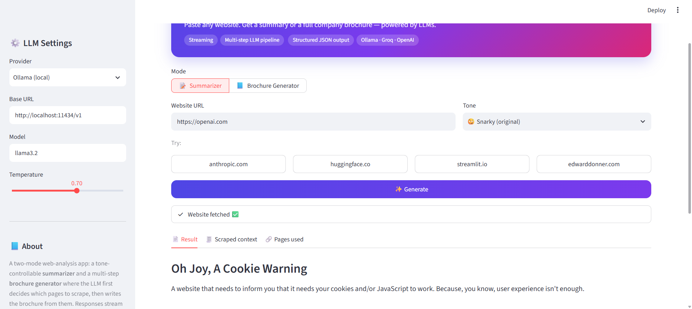
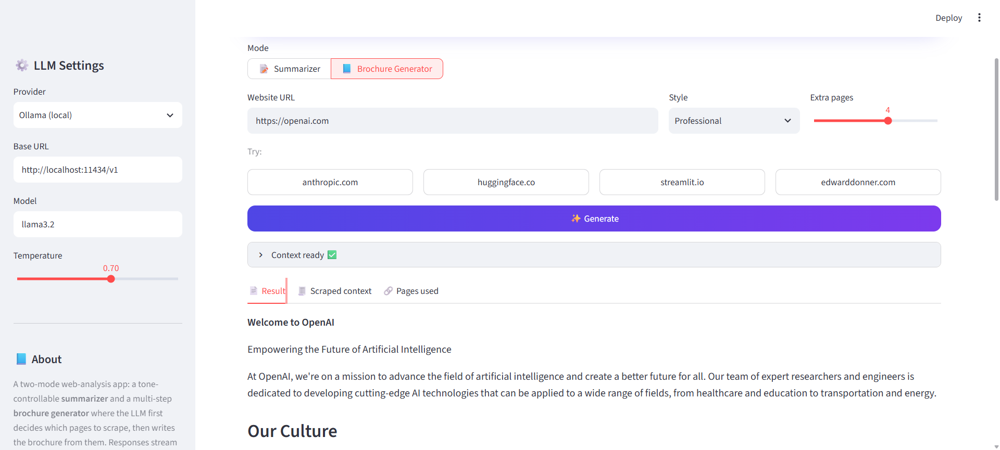

# 🌐 Web Insight AI

LLM-powered website summarizer and company brochure generator, built with Streamlit.
Paste any URL and get a tone-controlled summary or a full brochure, streamed live.
Runs on a local model via Ollama or on hosted OpenAI-compatible APIs (Groq, OpenAI, OpenRouter).

**[Live Demo](https://YOUR-APP.streamlit.app)** ·  

<!-- Add a screenshot or GIF here:  -->

## ✨ Features

- **Summarizer mode** with selectable tone: snarky, professional, ELI5, pirate, executive bullets
- **Brochure generator mode**, a multi-step LLM pipeline:
  1. Scrape all links from the landing page
  2. Ask the LLM which pages matter (structured JSON output, with a fallback for providers without JSON mode)
  3. Scrape the selected pages (About, Careers, Customers, etc.)
  4. Stream a brochure written from the combined context
- **Provider-agnostic**: Ollama (local), Groq, OpenAI, OpenRouter, or any OpenAI-compatible endpoint
- **Token streaming** with `st.write_stream`
- **Cached scraping** with `st.cache_data`
- **Transparency tabs**: see the exact scraped context and the pages the model used
- **Secure key handling**: secrets stay server-side and are never sent to the browser
- Markdown download, run metrics, and clear error messages for common failures

## 🧱 Project structure

```
├── app.py            # Streamlit UI + LLM pipelines
├── scraper.py        # Website fetching and cleaning (BeautifulSoup)
├── requirements.txt
└── .streamlit/
    └── secrets.toml  # local only, git-ignored
```

## 🚀 Run locally

```bash
git clone https://github.com/tnshkAI/Web-Insight-AI-LLM-Powered-Website-Summarizer-Brochure-Generator.git
cd Web-Insight-AI-LLM-Powered-Website-Summarizer-Brochure-Generator
pip install -r requirements.txt

# Option A: local model
ollama pull llama3.2
streamlit run app.py

# Option B: hosted model (e.g. Groq): add a key in the sidebar, or in secrets.toml
streamlit run app.py
```

## 🔐 Configuration

Create `.streamlit/secrets.toml` (never commit this file):

```toml
LLM_PROVIDER = "Groq (hosted, free tier)"
LLM_API_KEY  = "your-key-here"
# Optional:
# LLM_MODEL    = "llama-3.1-8b-instant"
# LLM_BASE_URL = "https://api.groq.com/openai/v1"
```

Visitors can also paste their own key in the sidebar. It is used only for their session.
The server key is used only for the provider and base URL you configured, so it can't be redirected elsewhere.

## ☁️ Deploy on Streamlit Community Cloud

1. Push the repo to GitHub (without secrets).
2. Create the app at [share.streamlit.io](https://share.streamlit.io).
3. Paste your secrets under **Settings → Secrets**.

Note: a deployed app can't reach `localhost`, so use a hosted provider there.

## 🛠️ Tech stack

Python · Streamlit · OpenAI SDK (OpenAI-compatible APIs) · Ollama · BeautifulSoup · Requests

## 📌 Limitations

- Only static HTML is scraped; JavaScript-rendered pages may return little content.
- Page text is truncated to keep prompts small, so very long sites are only partially covered.
- Output quality depends on the chosen model; small local models may struggle with the JSON link-selection step.

## 👤 Author

**Tanishk Saini** · [GitHub](https://github.com/tnshkAI) · [LinkedIn](https://linkedin.com/in/YOUR-LINKEDIN)
